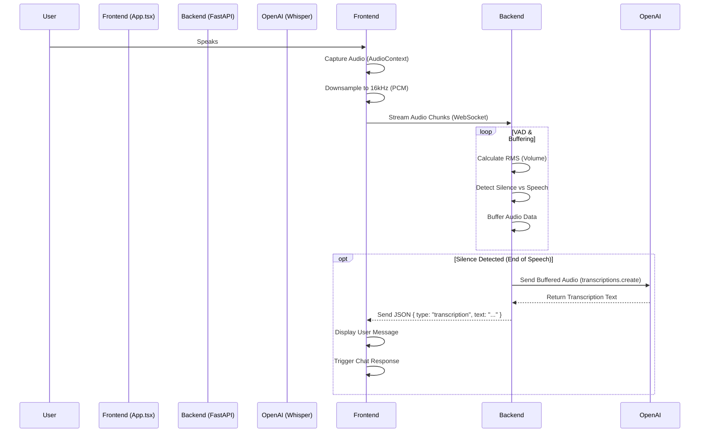

# Streaming STT Implementation Changes

This document details the migration from the legacy Web Speech API (`SpeechRecognition`) to a robust, low-latency **Streaming Speech-to-Text (STT)** architecture using **OpenAI Whisper** via WebSockets.

## 1. Architecture Overview

The new system captures raw audio in the browser, streams it to the backend via WebSocket, performs Voice Activity Detection (VAD) on the server, and uses OpenAI's Whisper API for high-quality transcription.

## 2. Backend Changes (`backend/main.py`)

### A. New WebSocket Endpoint
*   **Endpoint**: `/api/stt/stream`
*   **Protocol**: WebSocket
*   **Functionality**:
    *   Accepts continuous binary audio streams.
    *   Maintains a buffer of audio data.
    *   Implements server-side **Voice Activity Detection (VAD)**.

### B. Voice Activity Detection (VAD)
*   **Logic**: Calculates the Root Mean Square (RMS) amplitude of incoming audio chunks.
*   **Library**: Switched from `audioop` (deprecated) to `numpy` for robust numerical calculation.
*   **Parameters**:
    *   `SILENCE_THRESHOLD`: Threshold to distinguish speech from background noise.
    *   `SILENCE_DURATION`: Duration of silence (1.5s) required to trigger transcription.

### C. OpenAI Whisper Integration
*   **Model**: `whisper-1`
*   **Process**:
    1.  When silence is detected, the buffered audio is saved to a temporary WAV file.
    2.  The file is sent to OpenAI's `client.audio.transcriptions.create` API.
    3.  The resulting text is sent back to the frontend.

### D. Dependencies
*   Added `numpy` for audio processing.
*   Added `python-multipart` (implied for file handling).

## 3. Frontend Changes (`app/App.tsx`)

### A. Audio Capture & Streaming
*   **New Function**: `setupWebSocketSTT`
*   **Technology**: Uses `AudioContext` and `ScriptProcessorNode` (or `AudioWorklet` in future) to capture raw PCM audio.
*   **Processing**:
    *   Downsamples microphone input to **16kHz** (optimal for Whisper).
    *   Converts `Float32` audio data to `Int16` PCM format.
    *   Streams binary chunks directly to the WebSocket.

### B. Legacy Code Removal
*   **Removed**: All references to `window.SpeechRecognition` and `webkitSpeechRecognition`.
*   **Reason**: The Web Speech API was inconsistent across browsers and had high latency/poor accuracy compared to Whisper.

### C. Integration
*   **`setupSTTMode`**: Updated to initialize the WebSocket connection instead of the SpeechRecognition engine.
*   **Error Handling**: Added robust error handling for WebSocket disconnections and audio capture failures.

## 4. Configuration

*   **Environment Variable**: `NEXT_PUBLIC_USE_STT_MODE`
    *   `ON`: Uses this new Streaming STT + GPT-4o-mini + Streaming TTS architecture (Cost-effective).
    *   `OFF`: Uses OpenAI Realtime API (WebRTC) (Higher cost, lower latency).

## 5. Benefits

1.  **Consistency**: Works identically across all modern browsers (Chrome, Firefox, Safari).
2.  **Accuracy**: OpenAI Whisper provides significantly better transcription than browser built-ins.
3.  **Control**: Server-side VAD allows fine-tuning of silence detection and interaction pacing.
4.  **Extensibility**: The audio stream can be easily piped to other services (e.g., archival, sentiment analysis) in the future.
